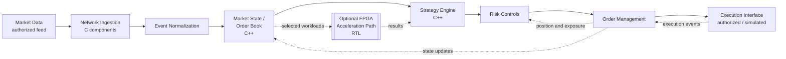

# JP Murugan

**FPGA-Accelerated High-Frequency Trading for Prediction Markets**

> **Status: Target architecture and engineering direction.** This README describes the intended system design, the proposed technology stack, and the planned validation methodology. No component is documented here as complete, benchmarked, or validated on hardware. Sections marked **TBD** or **Not yet measured** will be updated as evidence becomes available.

---

## Table of Contents

1. [Overview](#1-overview)
2. [Motivation](#2-motivation)
3. [Engineering Objectives](#3-engineering-objectives)
4. [Key System-Design Principles](#4-key-system-design-principles)
5. [End-to-End Architecture](#5-end-to-end-architecture)
6. [Architecture Diagram](#6-architecture-diagram)
7. [Component Breakdown](#7-component-breakdown)
8. [Low-Latency Networking](#8-low-latency-networking)
9. [Order Book and Matching-Engine Design](#9-order-book-and-matching-engine-design)
10. [Strategy and Risk-Management Architecture](#10-strategy-and-risk-management-architecture)
11. [FPGA RTL and Hardware–Software Co-Design](#11-fpga-rtl-and-hardwaresoftware-co-design)
12. [Proposed Technology Stack](#12-proposed-technology-stack)
13. [Engineering Trade-offs](#13-engineering-trade-offs)
14. [Performance Methodology and Results](#14-performance-methodology-and-results)
15. [Testing and Validation Strategy](#15-testing-and-validation-strategy)
16. [Security and Operational Safeguards](#16-security-and-operational-safeguards)
17. [Development Roadmap](#17-development-roadmap)
18. [Current Implementation Status and Limitations](#18-current-implementation-status-and-limitations)
19. [Future Research Directions](#19-future-research-directions)
20. [Disclaimer](#20-disclaimer)
21. [License and Acknowledgments](#21-license-and-acknowledgments)

---

## 1. Overview

JP Murugan is an end-to-end, low-latency trading system design for prediction markets. It combines custom networking, market-data processing, order-book management, strategy evaluation, risk controls, order execution, and an optional FPGA acceleration path into a single architecture.

The project is concerned with the infrastructure that surrounds a trading decision: how market events arrive, how they are represented and validated, how state is maintained, how decisions are checked against risk limits, and how the resulting actions are executed and reconciled. Strategy logic is one component among many. The engineering focus is on predictability, correctness, and measurable latency.

## 2. Motivation

Market infrastructure is a demanding systems problem. Events arrive in bursts, ordering and staleness matter, and a single incorrect state transition can propagate into incorrect decisions. Latency budgets are set by the slowest stage in a pipeline, which makes whole-system measurement as important as local optimization.

Prediction markets offer a constrained and well-defined setting for exploring these problems. Their market structures, contract formats, and event cadence differ from those of equity or futures venues, which makes them a useful place to examine the trade-offs without assuming the conventions of any single exchange. Any real-market use depends on authorized access and rule compliance, as described in [Disclaimer](#20-disclaimer).

## 3. Engineering Objectives

- Design a pipeline in which each stage has explicit inputs, outputs, and failure behavior.
- Build a deterministic market-state representation that can be replayed and verified.
- Explore low-level networking options and their costs, including kernel and user-space approaches.
- Separate strategy computation from order execution and risk enforcement.
- Establish a latency measurement methodology based on distributions, not single results.
- Evaluate which workloads, if any, benefit from FPGA implementation under measured conditions.
- Document design decisions and their trade-offs for technical review.

## 4. Key System-Design Principles

- **Correctness before speed.** A fast system that produces incorrect market state or unauthorized orders is a failure.
- **Risk controls are part of the core path.** Validation and limits are required components, not optional modules.
- **Determinism where possible.** Given the same input sequence, state transitions should produce the same output.
- **Explicit boundaries.** Each component should have a defined interface, so that it can be tested, replaced, or accelerated independently.
- **Measure, then optimize.** Optimization decisions should be driven by profiling data from reproducible experiments.
- **Simulation is not evidence of market performance.** Simulated results establish internal consistency, not profitability or exchange behavior.

## 5. End-to-End Architecture

The intended pipeline is:

1. **Market-data ingestion.** Receive events through authorized interfaces, parse and validate them, and normalize them into a consistent internal representation. Track sequence numbers, timestamps, stale data, and sequence gaps where the source protocol provides them.
2. **Low-level networking.** Handle packet reception, buffering, and batching, with the data path designed to minimize copies and system-call overhead.
3. **Market state and order book.** Apply normalized events to market state. Maintain order-book consistency where the protocol provides depth information, and define explicit handling for invalid updates, out-of-order events, and gaps.
4. **Strategy and decision engine.** Evaluate signals and pricing logic against current state and position. Emit intents, not orders.
5. **Risk controls.** Validate each intent against position, exposure, size, loss, staleness, and duplication rules before it can proceed.
6. **Order management and execution.** Convert approved intents into order requests, track their lifecycle, and reconcile acknowledgments, rejections, fills, cancellations, and timeouts.
7. **Execution interface.** Send orders through an authorized interface, or through a simulated venue during development.
8. **Feedback.** Execution events and state changes return to market state, order management, and risk controls.

The FPGA path is optional and applies only to workloads selected through profiling (see [FPGA RTL and Hardware–Software Co-Design](#11-fpga-rtl-and-hardwaresoftware-co-design)).

## 6. Architecture Diagram

**Target Architecture.** The diagram shows the intended design, not verified implementation.

## 7. Component Breakdown

| Component | Responsibility | Primary language / target | Status |
|---|---|---|---|
| Network ingestion | Receive and buffer packets; expose batches to parsing | C | Design |
| Event normalization | Parse, validate, and map messages to internal events | C / C++ | Design |
| Market state | Maintain book or market state; detect gaps and staleness | C++ | Design |
| Strategy engine | Compute signals and emit trade intents | C++ | Design |
| Risk controls | Enforce limits; gate every outbound intent | C++ | Design |
| Order management | Track order lifecycle and reconcile execution events | C++ | Design |
| Execution interface | Communicate with authorized or simulated venues | C++ | Design |
| Matching simulator | Deterministic internal matching for testing | C++ | Design |
| FPGA modules | Selected fixed-width pipeline stages | Verilog / VHDL | Design, not started or TBD |
| Telemetry | Timestamps, counters, and latency histograms | C / C++ | Design |

## 8. Low-Latency Networking

Network handling determines how quickly events reach the rest of the system, and it is often the largest source of variable latency. This project examines the following approaches as design options:

- **Standard kernel networking.** Packets traverse the kernel stack and are delivered to user space through socket interfaces. This is the most portable and debuggable path, but it incurs context switches, copies, and interrupt-handling costs.
- **Raw sockets and packet capture.** These expose frames to user space and are useful for inspection and development. They do not constitute a kernel-bypass networking stack, and their performance characteristics differ substantially from specialized approaches.
- **Kernel-bypass and user-space networking.** Frameworks that map network interface memory into user space can reduce copies and system-call overhead. These approaches add operational complexity, require specific hardware or driver support, and are not assumed to be part of this project.
- **Batching and buffer management.** Processing events in batches amortizes per-packet overhead, but increases the latency of individual events. Buffer sizing governs how the system behaves under bursts.

Design decisions in this area will depend on measured bottlenecks. No networking approach is treated as implemented until its behavior is observed in reproducible tests.

## 9. Order Book and Matching-Engine Design

### 9.1 Market State

The order book is represented using structures chosen for the access patterns of the target protocol: price-level indexing for depth updates, and order-level indexing for cancellations and modifications. Event-driven updates must be applied in sequence, and invalid updates must be detected and rejected rather than silently applied.

Key concerns include:

- Sequence gaps and out-of-order events, which may require resynchronization.
- Stale state, which should be flagged and should block decisions that depend on it.
- Crossed or inconsistent books, which indicate a state error.
- Recovery from a snapshot or replay, which must be verified against the source.

### 9.2 Internal Matching Engine

The project includes a planned internal matching engine for simulation and testing. Its purpose is to provide a deterministic environment in which strategies, risk controls, and order lifecycle logic can be exercised.

The engine is planned to implement price-time priority, with explicit rules for order submission, cancellation, partial fills, and resting-order behavior. These rules are a model, not a claim about any exchange. The authoritative matching rules belong to the venue and must be verified against its documentation before results from the simulator are interpreted as applicable to that venue.

## 10. Strategy and Risk-Management Architecture

### 10.1 Strategy Interface

Strategies implement a defined interface that receives normalized market state and position information and returns trade intents. Strategies do not submit orders directly. This separation allows the same strategy code to run against simulated and authorized execution paths, and allows risk controls to be applied uniformly.

Strategy examples are included only to exercise the architecture. They do not establish profitability, and no backtest or simulation result in this project should be read as evidence of trading performance.

### 10.2 Risk Controls

Every intent passes through risk controls before it can become an order. The planned checks include:

- **Position limits** per instrument and in aggregate.
- **Exposure limits** across correlated instruments or events.
- **Order-size limits** per order and per interval.
- **Loss limits** with defined behavior on breach.
- **Stale-data checks**, which block decisions based on state that is too old or incomplete.
- **Duplicate-order prevention**, using client-side identifiers and state tracking.
- **Emergency stop**, which halts new order submission and requires explicit action to resume.

Limit values are configuration, not constants, and their defaults are to be defined. Risk controls are subject to independent testing before any use with authorized connectivity.

### 10.3 Order Lifecycle

Orders move through explicit states, including submitted, acknowledged, partially filled, filled, cancel-pending, cancelled, rejected, and timed out. Each transition must be triggered by a defined event. Timeouts require reconciliation before any retry, because a request may have reached the venue even if no acknowledgment was received.

## 11. FPGA RTL and Hardware–Software Co-Design

### 11.1 Division of Responsibility

**Software responsibilities** (planned) include protocol handling, configuration and orchestration, strategy logic, risk management, order lifecycle management, and logging and observability. These components require flexibility and are expected to change frequently.

**FPGA responsibilities** (candidate, subject to profiling) include fixed-width data processing, parallel computation over independent data, selected deterministic pipeline stages, and workloads where a hardware implementation offers a measurable advantage over an optimized software baseline.

The final division will be determined by profiling, correctness requirements, hardware constraints, and measured results. The FPGA is not assumed to outperform optimized software for any given workload. Transfer costs between host and device may dominate for small units of work, and this is one of the questions the project intends to measure.

### 11.2 RTL Design Considerations

RTL modules are planned in Verilog or VHDL, using pipelined datapaths, deterministic state machines, and fixed-width arithmetic. Key design concerns include:

- Data representation and precision, including explicit handling of overflow and saturation.
- Clock-domain crossings where the hardware interfaces with external signals.
- Synchronization between host and device, including buffering and backpressure.
- Latency and throughput, which depend on pipeline depth and clock rate.

### 11.3 Verification Stages

The following stages are distinct and must each be completed before the next is treated as evidence:

1. **RTL simulation** verifies functional behavior against a reference model.
2. **Synthesis** maps the design to target hardware resources.
3. **Timing analysis** determines whether the design meets its clock constraints.
4. **Resource utilization** reports logic, memory, and routing consumption.
5. **Hardware validation** exercises the design on a physical device.

Successful RTL simulation does not establish that the design synthesizes, meets timing, or operates correctly on hardware.

## 12. Proposed Technology Stack

This is a target stack. It is not a verified inventory of dependencies.

| Area | Proposed technology | Purpose |
|---|---|---|
| Networking and systems | C | Low-level ingestion and packet-handling components |
| Application logic | C++ | Order book, strategy interface, risk, and order management |
| FPGA | Verilog or VHDL | RTL for selected hardware modules |
| Build and automation | Bash | Build and development scripts |
| Research and tooling | Python | Simulation, test generation, and benchmark analysis |
| FPGA toolchain | TBD | Selected according to target device and vendor tools |
| Platform | Linux | Development, profiling, and network diagnostics |

Specific FPGA devices, vendor toolchains, build systems, third-party libraries, and exchange or broker APIs are not yet selected. They will be documented when chosen.

## 13. Engineering Trade-offs

- **Latency versus throughput.** Batching improves throughput but delays individual events. The appropriate balance depends on the workload and on which metric the system must meet.
- **CPU versus FPGA.** Hardware offers deterministic timing and parallelism for suitable workloads, but development is slower, debugging is harder, and iteration cycles are longer.
- **Copy-based versus zero-copy paths.** Copies simplify ownership and debugging. Zero-copy designs reduce overhead but increase coupling between components and the risk of lifetime errors.
- **Kernel versus user-space networking.** Kernel paths are portable and observable. User-space approaches can reduce overhead but depend on specific drivers and hardware, and they remove parts of the operating system's protections and tooling.
- **Dynamic versus predictable memory.** Preallocated pools give predictable behavior and avoid allocation pauses. They require capacity planning and make memory use less flexible.
- **Software flexibility versus fixed pipelines.** Software can change quickly. Fixed hardware pipelines are faster and more deterministic once built, but changes require re-synthesis and re-verification.
- **Precision and overflow.** Fixed-width arithmetic is efficient and deterministic, but it requires explicit range analysis and handling of overflow and rounding.
- **Determinism versus external events.** The system can be deterministic internally, but external market and network events are asynchronous. Replay and simulation help, but do not eliminate this gap.
- **Performance versus maintainability.** Hand-tuned code and custom hardware are harder to maintain and audit. Optimization should be applied where measurement shows it matters.
- **Speed versus risk control.** Every check adds latency. The project treats risk checks as required, and optimization is applied to their implementation, not by removing them.

## 14. Performance Methodology and Results

### 14.1 What Will Be Measured

- Market-event processing latency, from ingestion to state update.
- Order-book update throughput under representative event rates.
- Strategy evaluation time per decision.
- Order construction and validation time, including risk checks.
- FPGA pipeline latency, including host–device transfer.
- CPU and memory utilization.
- Queue depth and behavior under load, including dropped events.
- End-to-end simulated execution latency.

Latency results will be reported as distributions, including median, p95, p99, and maximum, rather than as single best-case figures.

### 14.2 Measurement Requirements

Meaningful comparisons require:

- Documented hardware and software environments, including OS, kernel, compiler, and FPGA device where applicable.
- Repeatable workloads with recorded inputs.
- Equivalent inputs and correctness criteria across compared implementations.
- Warm-up periods and measurement windows, documented in advance.
- Separate reporting for simulation, synthesis, hardware, and any exchange-connected measurements. These are not interchangeable.
- Application, network, FPGA pipeline, and end-to-end latency reported separately.

### 14.3 Results

| Metric | Measurement context | Median | p95 | p99 | Max | Status |
|---|---|---|---|---|---|---|
| Market-event processing latency | Software, simulated feed | TBD | TBD | TBD | TBD | Not yet measured |
| Order-book update throughput | Software, replayed feed | TBD | — | — | — | Not yet measured |
| Strategy evaluation time | Software | TBD | TBD | TBD | TBD | Not yet measured |
| Order validation time | Software, risk checks enabled | TBD | TBD | TBD | TBD | Not yet measured |
| FPGA pipeline latency | Hardware, including transfer | TBD | TBD | TBD | TBD | Not yet measured |
| End-to-end simulated latency | Software + simulated venue | TBD | TBD | TBD | TBD | Not yet measured |

No values in this table have been measured. Entries will be filled only from reproducible experiments with documented environments.

## 15. Testing and Validation Strategy

- **Unit tests** for parsers, order-book operations, risk checks, and order-state transitions.
- **Replay tests** that feed recorded or generated event sequences through the pipeline and verify resulting state.
- **Property-based and fuzz testing** for malformed messages, sequence gaps, and invalid updates.
- **Matching-engine tests** verifying price-time priority, cancellation, and partial-fill behavior against specification.
- **Failure-injection tests** for network loss, delayed acknowledgments, duplicate messages, and timeouts.
- **RTL verification** against a software reference model, covering functional behavior and corner cases in arithmetic.
- **Paper trading** against a simulated or authorized sandbox environment, before any further step.

Test coverage and test results are not documented here because the test suite is not yet established.

## 16. Security and Operational Safeguards

- **Credential handling.** API credentials must not appear in source, logs, or repository history. Use runtime injection and rotate exposed credentials immediately.
- **Order gating.** No order reaches an execution interface without passing risk controls and an explicit mode check (simulated, paper, or live).
- **Kill switch.** An emergency stop must halt order submission independently of the strategy engine.
- **Audit logging.** Decisions, intents, risk outcomes, and orders should be recorded with timestamps and identifiers sufficient for reconstruction.
- **Reconciliation.** Positions and open orders should be reconciled against venue state on startup and after failures.
- **Dependency and supply-chain hygiene.** Dependencies should be pinned and reviewed.
- **Environment separation.** Development, simulation, and any authorized connectivity should use separate configurations and credentials.

These are planned safeguards. Their implementation status is not documented here.

## 17. Development Roadmap

The phases below are planned milestones. None is complete.

**Phase 1: Foundations.** Define data models, interfaces, and correctness requirements. Establish a reproducible development environment.

**Phase 2: Software Engine.** Develop market-event processing, order-book logic, and deterministic simulation.

**Phase 3: Risk and Execution.** Add order lifecycle management, validation, and failure-handling mechanisms.

**Phase 4: Performance Engineering.** Profile bottlenecks and establish repeatable latency and throughput benchmarks.

**Phase 5: FPGA RTL.** Implement selected hardware modules, simulate them, synthesize RTL, and analyze timing and resource utilization.

**Phase 6: Hardware Integration.** Validate software–FPGA communication and compare measured results against the software baseline.

**Phase 7: Authorized Market Integration.** Evaluate approved interfaces, operational safeguards, and controlled paper-trading workflows. Live execution is not part of the current plan and would require separate review.

## 18. Current Implementation Status and Limitations

| Area | Status |
|---|---|
| Target architecture | Specified in this document |
| Software components | Design stage; implementation status to be confirmed |
| Network ingestion | Design stage |
| Order book and matching engine | Design stage |
| Strategy and risk controls | Design stage |
| FPGA RTL | Design stage; no synthesis or hardware results |
| Performance results | None measured |
| Exchange or broker integration | None |
| Build and execution instructions | To be documented with implementation |

**Limitations:**

- This is a prototype-stage design. It is not suitable for unattended live trading.
- No profitability, speed advantage, or market performance is claimed.
- Simulation results are internal to the simulator and do not transfer to any venue without verification.
- The FPGA path has not been validated, and its advantage over software is unestablished.
- Market-specific protocol rules, fee structures, and matching behavior must be verified against venue documentation.

## 19. Future Research Directions

- Comparison of kernel, raw-socket, and user-space packet paths under controlled workloads.
- Evaluation of order-book data structures for different update patterns.
- Measurement of host–FPGA transfer overhead against the computation it accelerates.
- Study of fixed-width arithmetic error bounds for pricing calculations.
- Analysis of how queueing and burst behavior affect tail latency.
- Formal or model-based verification of order-lifecycle state machines.

## 20. Disclaimer

This project is an engineering study and a prototype design. It is not financial advice, does not constitute a trading system ready for use with real capital, and makes no claims about profitability.

Operating against real markets requires authorized market-data and execution access, compliance with applicable exchange rules and financial regulations, independent validation of software and hardware, and appropriate financial risk controls. The author and contributors accept no responsibility for losses arising from use of this code or its designs.

## 21. License and Acknowledgments

**License:** To be confirmed by the project owner. No license is asserted in this document.

**Acknowledgments:** Third-party libraries, tools, and open-source projects used in the implementation should be credited here once selected and confirmed.

**Trademarks:** Names of exchanges, brokers, FPGA vendors, and tools referenced in this document are the property of their respective owners and are used descriptively. The project is not affiliated with or endorsed by any of them.
